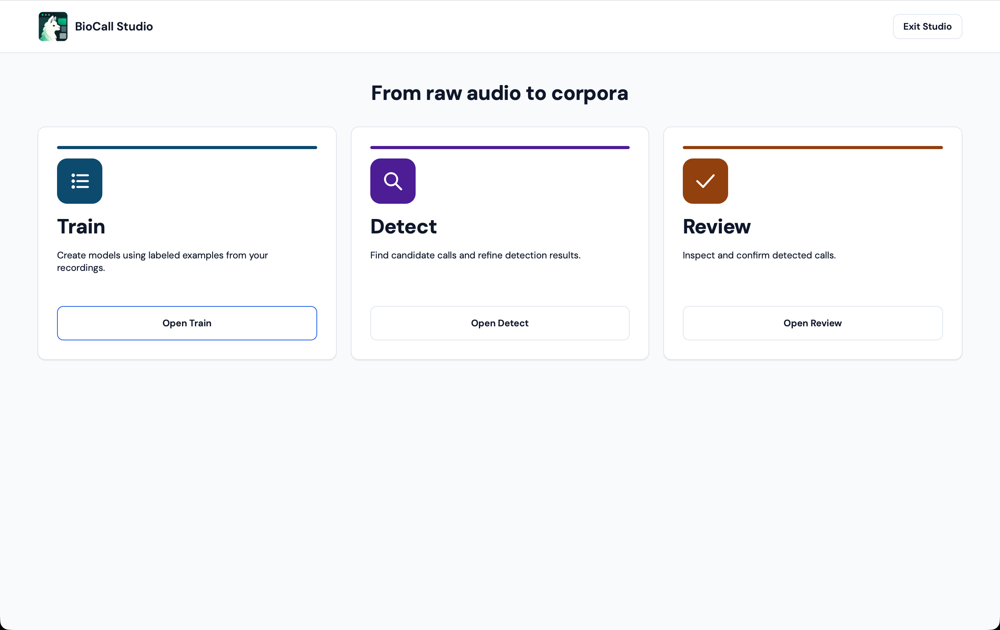

<p align="center">
  
</p>

# BioCall Studio

**Turn field recordings into reproducible call candidates, then make the human decisions.** BioCall Studio is a local desktop application for acoustic researchers who train species- or call-specific classifiers, examine detections across WAV recordings, and publish carefully traceable reviewed audio. One application connects **Train → Detect → Review** without sending field audio to a hosted service.

<p align="center">
  
</p>

## Follow a recording through the workspace

### 1. Train from known calls

Choose a local **Collection** of original WAV recordings and source-time-labeled positive call excerpts. Build an immutable Dataset with train/validation splits, then train a convolutional neural network (CNN) or random forest (RF). The Collection and resulting Dataset, Runs, Models and measurements retain their scientific provenance.


*Actual alpaca-hum training capture, not a fabricated curve. The Worker was still running when photographed; its incomplete Model was subsequently cancelled rather than published.*

### 2. Detect candidates in recordings

Select a compatible trained Model and an independent recording Collection. Detect scans WAV sources, records source-time candidate intervals in immutable Results, and can apply RF refinement as a second stage. It does not rewrite the source audio or treat a model score as a human verification.


### 3. Review and export with human provenance

Open a **verified Detect Result** in Review. Browse the spectrogram Gallery, List, or One by one, listen to context audio, and mark each eligible candidate **Call**, **Not a call**, or leave it **Unreviewed**. You may finalize a partially reviewed session with an explicit warning. Review can export individual WAV snippets, a concatenated WAV with Raven TSV, or both; **Not a call** candidates are excluded, while **Unreviewed** candidates remain clearly distinguished as model-only.


**What these images actually show:** a genuine human-verified alpaca-hum source cohort with **64 source-time candidate intervals**. The captured Review session has **18 Call**, **0 Not a call**, and **46 intentionally Unreviewed** decisions. The 46 are **not human-confirmed negatives**. The live native macOS screenshots, underlying source/provenance hashes, full [screenshot gallery and methods](docs/design/evidence/release-real-data/README.md), and [machine-readable capture metadata](docs/design/evidence/release-real-data/capture-metadata.json) are committed. These screenshots document source-app behavior, **not** installed-app qualification.

## Run from source

BioCall Studio supports **Python 3.11–3.13**. Native macOS has development and screenshot evidence; native Windows execution, installers, signing, notarization, and clean-install qualification remain **unverified release gates**. No packaged desktop installer is offered here.

From a checkout on macOS or Linux, install the **published, hash-verified** `alp-ui==0.1.0a1` and `bioacoustics-dl-toolbox[rf]==0.3.0` wheels using the exact commands in [Development — released wheels](docs/DEVELOPMENT.md#install-from-published-wheels), then launch:

```bash
.venv/bin/python -m biocall_studio
```

For a researcher starting with recordings, see [Selecting a Collection](docs/wiki/SELECTING_A_COLLECTION.md), [Train configuration guidance](docs/wiki/TRAINING_CONFIGURATION.md), and the [manual Train workflow](docs/MANUAL_WORKFLOW.md). For development, tests, and reproducibility, see [Development](docs/DEVELOPMENT.md), [system architecture](docs/ARCHITECTURE.md), and [the Detect/Review data contracts](docs/PREDICTION.md).

## Source licensing and release status

**BioCall Studio has no declared application license in this repository:** there is currently no root `LICENSE` file or application license declaration in `pyproject.toml`. The source being visible does not itself authorize redistribution. Therefore **no application license badge** is displayed or implied. The separately published scientific toolbox is **GPL-3.0-only**, `alp-ui` uses **MIT**, and PySide6/Qt have their own license and redistribution obligations. Resolve the actual Studio application license and third-party compliance before publishing binaries; see the [release process](docs/RELEASE_PROCESS.md).

This is an in-development source application. **No macOS/Windows installer, Studio release tag, native install/signing approval, or final full-suite qualification is claimed.**
