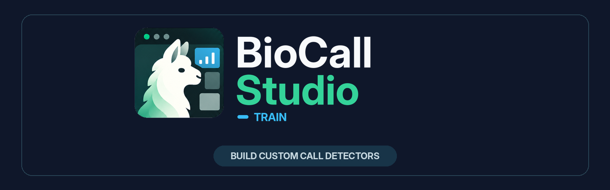

<p align="center">
  
</p>

# BioCall Studio Train

Build and refine custom animal-call detectors from your own recordings, on your own computer.

BioCall Studio Train guides bioacoustics researchers from a folder of WAV recordings and known
positive examples to a reproducible training Dataset and a verified CNN or Random Forest Model.
It keeps source audio in place and read-only, explains fixable data problems, and records the
configuration and provenance behind every published result.

> **Development preview:** the native macOS application is working from source. Packaged macOS
> and Windows installers are on the roadmap and are not available yet.

## What it does

- Checks real WAV headers and positive-example filenames before training.
- Builds balanced, source-grouped Datasets without copying or changing source recordings.
- Trains genuine local CPU CNN and Random Forest models with measured validation results.
- Keeps immutable Datasets, Runs, Models, logs, and provenance in the Collection's `.alpaca/`
  workspace.
- Supports safe cancellation, recovery, local diagnostics, and an optional keep-awake setting for
  long runs.

BioCall Studio Train creates models; it does not apply them to new recordings. Automated detection
and expert review belong to the planned BioCall Studio Detect and Review applications.

## Install and run from source

You need Python **3.11–3.13**, Git, and adjacent checkouts of
`bioacoustics-dl-toolbox` and `alp-ui`. The commands below create a project-local environment and
do not install packages globally.

```bash
git clone git@github.com:darizae/biocall-studio-train.git
cd biocall-studio-train

python3 -m venv .venv
.venv/bin/python -m pip install --upgrade pip
.venv/bin/python -m pip install -e '../bioacoustics-dl-toolbox[rf]'
.venv/bin/python -m pip install -e '.[gui,test,integration]'
.venv/bin/python -m pip install -e ../alp-ui

.venv/bin/python -m biocall_studio_train
```

After installation, the console command is equivalent:

```bash
.venv/bin/biocall-studio-train
```

On Windows, use `.venv\Scripts\python.exe` instead of `.venv/bin/python`. Windows remains an
unqualified development environment until the native installer milestone is complete. See
[Development](docs/DEVELOPMENT.md) for environment troubleshooting and test commands.

## Prepare a Collection

Point the app at one folder containing your original recordings and exported positive examples:

```text
Rainforest-dawn/
  recordings/
    SITE_001.wav
  positives/
    SITE_001__start-012500ms__end-014900ms__call01.wav
```

The timestamps in a positive filename identify its interval in the original Source Recording and
use integer milliseconds. The app validates the relationship before it publishes metadata. Read
[Selecting a Collection](docs/wiki/SELECTING_A_COLLECTION.md) for the complete naming rules.

## A typical workflow

1. **Select and check a Collection.** Choose the existing folder; BioCall Studio Train reads WAV
   headers without importing or moving audio.

   

2. **Fix clear input problems.** The Collection view points to individual files and explains what
   needs attention before Dataset Build is enabled.

   

3. **Build a reproducible Dataset.** Choose source recordings, negative-window policy, split, and
   seed. Recordings stay grouped so one source cannot leak across train and validation.

   

4. **Configure and train.** Start with the compact controls, open detailed settings only when you
   need them, and save useful presets.

   

5. **Inspect the evidence.** Follow measured loss or feature importance, then reopen the verified
   Model together with its Dataset, Run, metrics, and provenance.

   

The [native evidence gallery](docs/design/evidence/README.md) contains the remaining normal,
narrow, empty, error, cancellation, diagnostics, Random Forest, safe-exit, and keep-awake states.
Its results come from generated real PCM WAV fixtures and genuine local training, not simulated
scientific output.

## Roadmap

- **Available from source:** Collection validation, Dataset Build, persisted Runs, CNN and Random
  Forest training, Model verification, diagnostics, safe exit, and optional keep-awake.
- **Next:** a signed, notarized, clean-install-tested macOS application and DMG.
- **Later:** a native Windows installer and Windows-specific path, DPI, accessibility, and Worker
  qualification.
- **Separate future applications:** BioCall Studio Detect for applying models and BioCall Studio
  Review for checking candidate calls.

## Development

Run the fast repository checks with:

```bash
.venv/bin/python scripts/verify_handoff.py
.venv/bin/python -m pytest -q tests/unit
.venv/bin/python -m pytest -q tests/integration
```

Native GUI evidence must be captured on a real desktop; Qt offscreen output is supplemental only.
Contributors should start with [AGENTS.md](AGENTS.md), then follow the
[task router](docs/agent/ROUTING.md) to the single active specification. The current release phase
is [Spec 06: macOS packaging and installer](docs/specs/06-macos-release-and-installer.md).

Brand assets are copied into this repository and documented in
[assets/branding](assets/branding/README.md); they are not a runtime dependency on the separate
brand-kit checkout.
