# alpaca Desktop Trainer

**A local desktop application for preparing supervised bioacoustics datasets and training CNN or Random Forest models.** Designed for working with existing WAV collections on your computer, without importing or moving your recordings.

> **Development preview:** The PySide6 application implements native Collection selection,
> cancellable WAV-header scanning, validation, cache publication and immutable Dataset Build with
> protected Negative Mining and source-grouped Splits, plus persisted supervised Worker Runs,
> cancellation, recovery and history. The native Training page now provides complete typed CNN/RF
> configuration and user-level saved presets. A genuine bounded CPU CNN executor publishes a
> verified immutable Model with measured validation results; Random Forest execution and installers
> remain planned. Never interpret a simulated browser run as scientific output.

## What you can do

Choose an existing folder with `recordings/` and `positives/`, scan real WAV headers without
copying audio, fix per-file validation issues, reopen published Collection metadata, and build a
verified immutable Dataset of real target/noise WAV Snippets. Dataset Build keeps each Source
Recording wholly in train or val. Follow actual stage progress, cancel safely, inspect failures and
Configure either model family from a published Dataset, inspect/reset detailed settings, save and
manage presets, and freeze a validated configuration handoff. Start genuine local CPU CNN Training,
inspect measured train/validation loss, reopen its structurally verified checkpoint, and navigate the
published Model's Dataset, Run, metrics and provenance. Random Forest execution remains disabled
until Spec 05c; this Trainer does not run prediction or score new recordings.

**Input folder example:**

```text
Rainforest-dawn/
  recordings/
    SITE_001.wav
  positives/
    SITE_001__start-012500ms__end-014900ms__call01.wav
```

Positive filename timestamps refer to the *original Source Recording* and are expressed in integer milliseconds. See [Selecting a Collection](docs/wiki/SELECTING_A_COLLECTION.md) for the complete naming rules.

## Current native application

These are real PySide6 application captures from macOS using the sibling `alp-ui` checkout. They
show the currently implemented native shell, Collection Scan, Dataset Build, Run lifecycle,
Training and Model views. Counts, loss and metrics come from generated real PCM WAV inputs and a
genuine CPU CNN Run; no simulated Model or training metric is presented.

**Select a Collection — native macOS app**

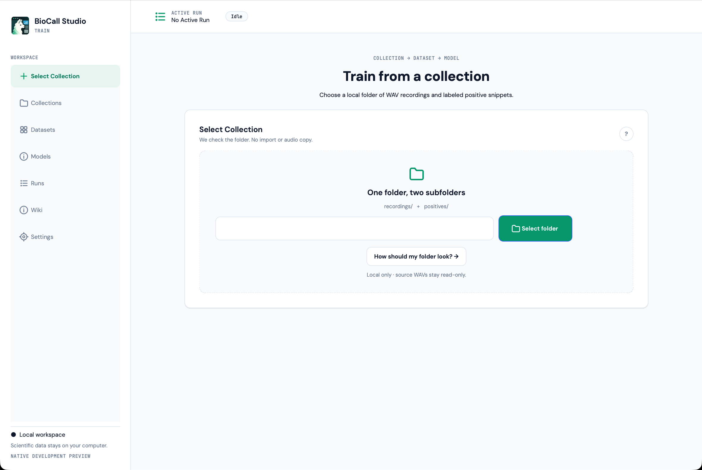

**Selecting a Collection guidance — native macOS app**

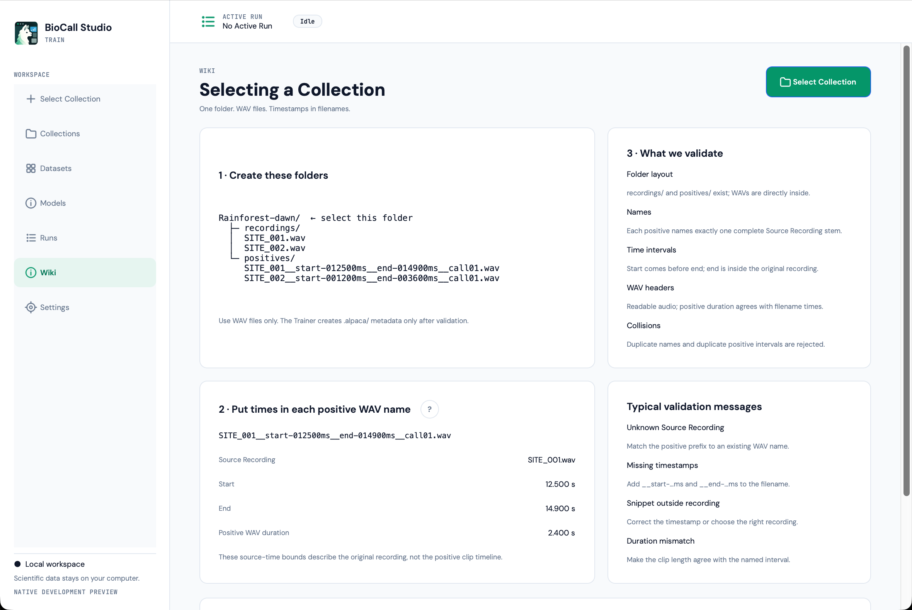

**Validated Collection after correcting and rescanning real WAVs — native macOS app**

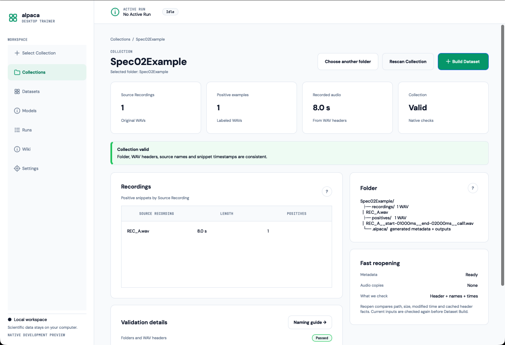

**Fixable per-file Collection validation — native macOS app**

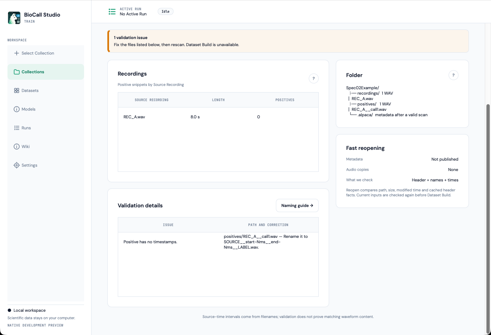

**Dataset Builder with real protected-window estimates — native macOS app**

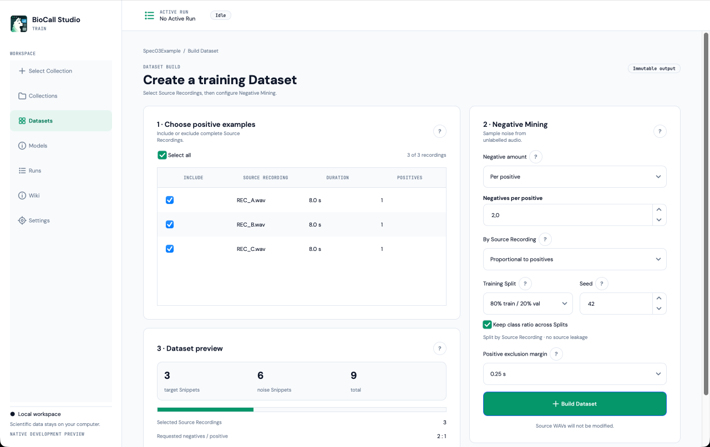

**Verified immutable Dataset detail — native macOS app**

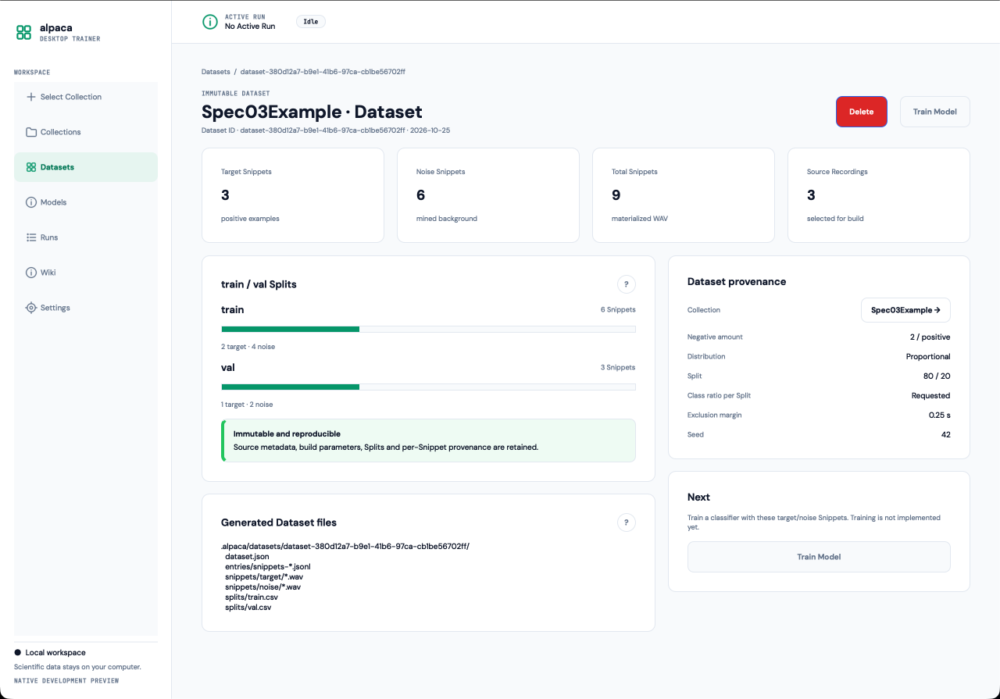

**Active Dataset Build Run — native macOS app**

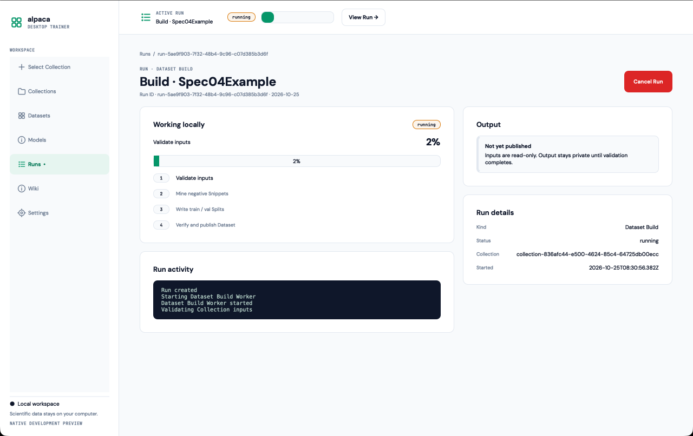

**Persisted Run history — native macOS app**

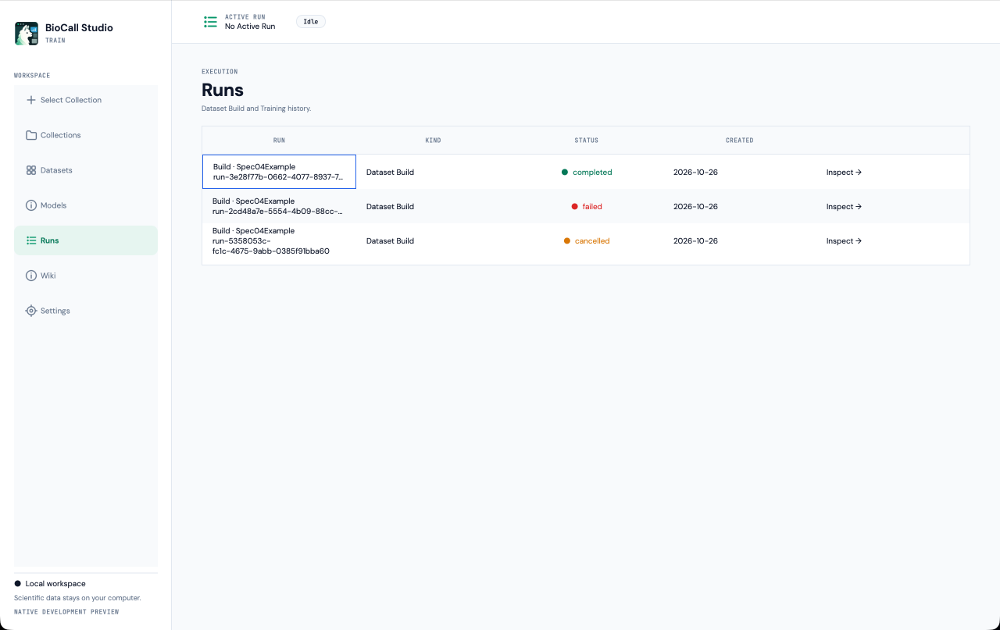

**CNN configuration with the compact primary roster — native macOS app**

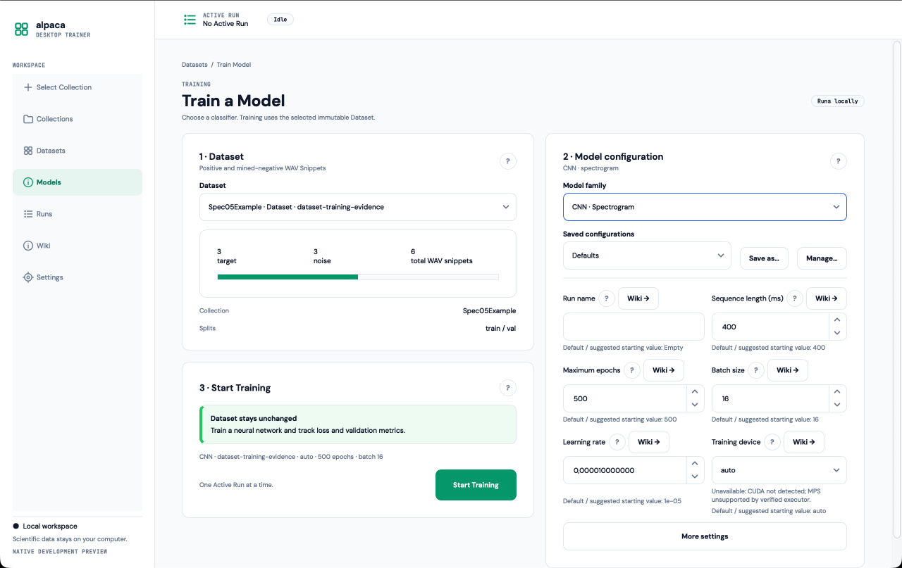

**Detailed CNN settings with a non-default value — native macOS app**

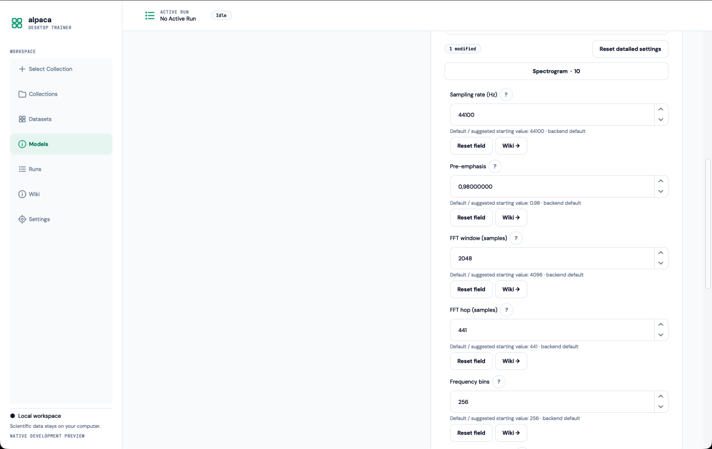

**Completed CNN Run with measured train/validation loss — native macOS app**

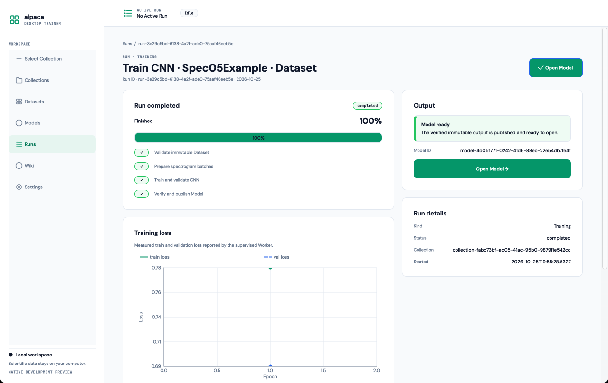

**Verified immutable CNN Model — native macOS app**

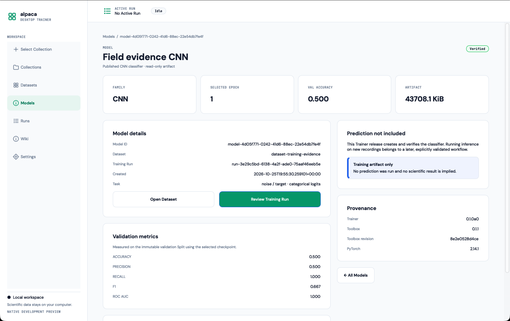

The complete [native evidence set and parity review](docs/design/evidence/README.md) also covers
Reading/cancel, Settings, all four initial empty routes, Builder underfill/busy states, Dataset
list/detail navigation, Worker cancellation/failure/completion/history, both Training families,
saved presets, genuine CNN loss, published Model list/detail, keyboard interactions and narrow
resized windows.

## Interactive design reference

The checked-in browser prototype remains the normative journey for later specs. Its images are
**design targets**, not screenshots of the current native app, and its sample data/training progress
are simulated.

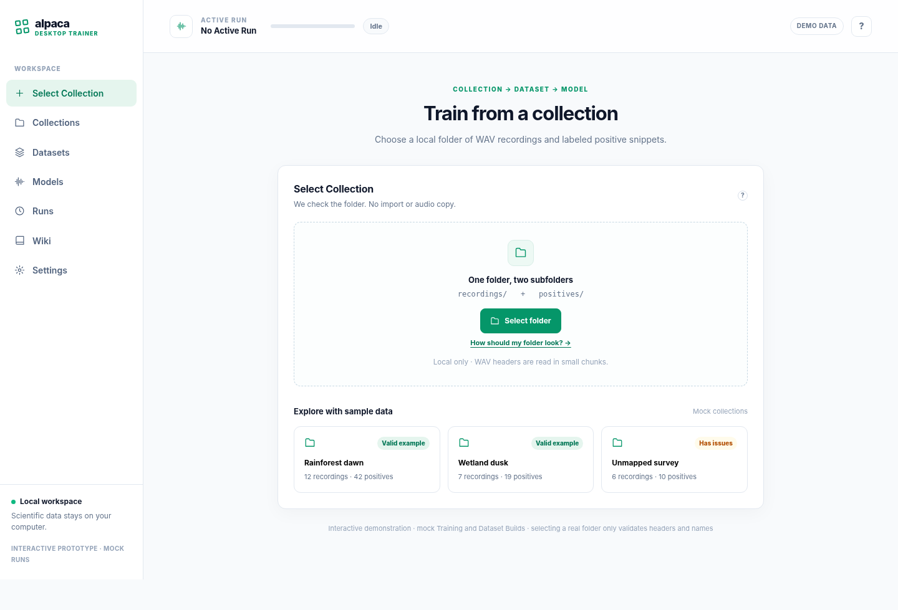

Explore the [interactive UX prototype](docs/design/prototypes/training-first/index.html) and the
blocking [prototype acceptance gate](docs/design/PROTOTYPE_ACCEPTANCE.md).

## Run the current development app (macOS)

Prerequisites: Python **3.11–3.13**, adjacent `../bioacoustics-dl-toolbox` at committed
revision `8e2e0528d4ce718005e194d426cde6e62fda0909`, the native
[`alp-ui`](docs/design/ALP_UI_CONSUMER_CONTRACT.md) checkout at `../alp-ui`, and Git LFS for the
versioned audio example. Use the repository root as your working directory. These instructions
install to a **project-local `.venv`**; no global Python packages are needed.

```bash
# From your repos/alpacaDesktopTrainer directory
python3 -m venv .venv
.venv/bin/python -m pip install --upgrade pip
.venv/bin/python -m pip install -e ../bioacoustics-dl-toolbox
.venv/bin/python -m pip install -e '.[gui,test,integration]'
.venv/bin/python -m pip install -e ../alp-ui

# Start the native PySide6 app
.venv/bin/python -m alpaca_desktop
```

If you have already installed the package in `.venv`, **launch it directly**:

```bash
.venv/bin/python -m alpaca_desktop
# Equivalent installed console entry point:
.venv/bin/alpaca-desktop
```

Optional isolated Application Settings, useful during development:

```bash
.venv/bin/python -m alpaca_desktop --settings-dir /tmp/alpaca-trainer-settings
```

On Windows the development interpreter path is `.venv\Scripts\python.exe`; Windows native UI/release qualification is scheduled for Spec 07. This is a development setup, **not** a packaged installer. For environment troubleshooting and test commands, see [Development](docs/DEVELOPMENT.md).

## Run checks

```bash
# Git LFS is needed only for versioned binary test fixtures in the actual checkout:
git lfs install
# If the repo tracks registered fixtures and you need those exact bytes:
# git lfs pull
# .venv/bin/python scripts/check_fixtures.py
.venv/bin/python scripts/verify_handoff.py
.venv/bin/python -m pytest -q tests/unit
# On a native macOS desktop (not merely Qt offscreen):
.venv/bin/python -m pytest -q tests/integration
```

`docs/priv/` contains optional machine-specific HPC source instructions in the **private handoff archive**; it must never be tracked by Git. The optional `tests/data/example_collection/` in an actual Git checkout contains synthetic WAVs, **not** confidential HPC exports. The transfer ZIP intentionally omits `tests/data/`; generating temporary real WAV test cases is supported. Windows and packaged-app tests remain future qualification gates.

## Developer documentation (start here if you are a coding agent)

Read [AGENTS.md](AGENTS.md) → [agent routing](docs/agent/ROUTING.md) → **only the active spec** in [specs index](docs/specs/README.md). Do **not** read the entire documentation tree by default.

**Current milestone:** [Spec 05b CNN training and Model foundation](docs/specs/05b-cnn-training-and-model-foundation.md)
is implemented with a genuine CPU Worker, measured results, immutable Model publication, trusted
fresh-process structural reload and native evidence. Real Random Forest execution remains Spec 05c;
macOS/Windows installed release qualification remains later work.

Reference map (open only for the task at hand): [vision](docs/VISION.md), [glossary](docs/GLOSSARY.md), [domain workflow](docs/models/USER_WORKFLOWS_AND_DATA_MODEL.md), [workflow rules](docs/models/WORKFLOW_RULES.md), [architecture](docs/ARCHITECTURE.md), [UX parity](docs/design/UX_PARITY_MATRIX.md), [scientific sibling source map](docs/agent/SOURCE_MAP.md), [unit testing](docs/UNIT_TESTING.md), [integration testing](docs/INTEGRATION_TESTING.md), [fixture policy](docs/INTEGRATION_TEST_DATA.md), [Git/branch delivery](docs/agent/GIT_DELIVERY.md). The scientific pipeline is referenced from the verified sibling `../alpaca-pipelines` checkout; it is not vendored here.
