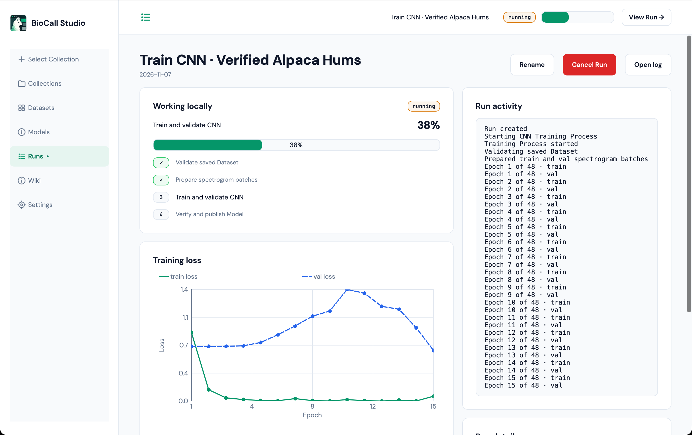
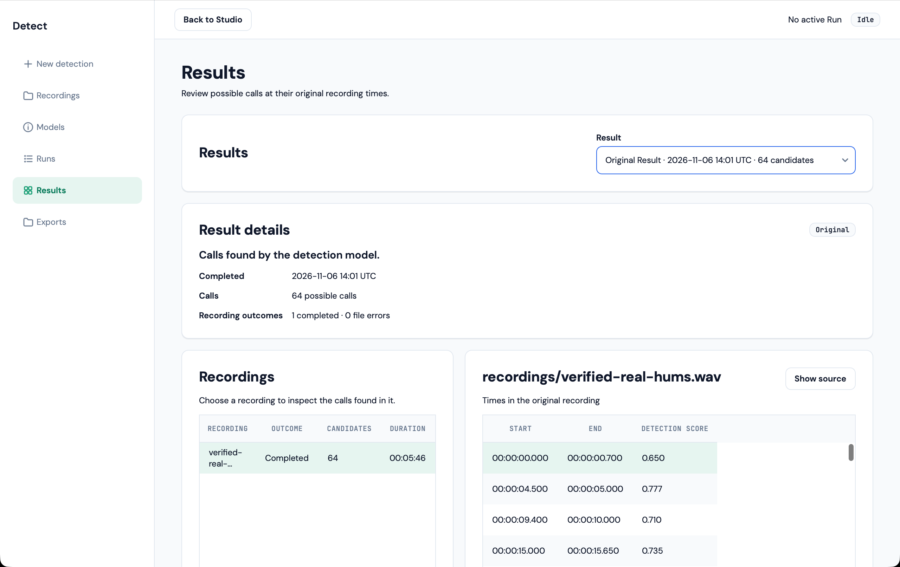
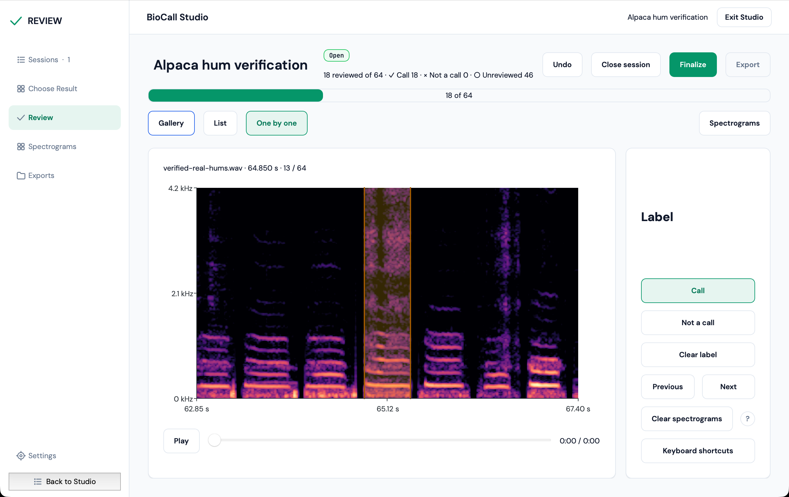

<p align="center">
  
</p>

# BioCall Studio

**Train, detect, and review animal vocalizations in one desktop application.**

BioCall Studio helps bioacoustics researchers work with field recordings—from training models on labeled calls to finding vocalizations in new audio and reviewing the results with spectrograms and playback.

## Explore the workflow

### Train

Create datasets from your recordings and labeled examples, train CNN or Random Forest classifiers, and follow training progress and results.



### Detect

Analyze recordings with a trained model. Browse detected vocalizations, see where they occur in the source audio, and optionally refine predictions with a Random Forest classifier.



### Review

Explore detections in a spectrogram gallery or inspect them individually. Listen to audio, label candidates, manage review sessions, and export reviewed WAV audio with Raven-compatible annotations.



## Download BioCall Studio — v0.1.0a1 Alpha

- **Download for Windows (64-bit)** — [BioCall-Studio-0.1.0a1-windows-x86_64.exe](https://github.com/darizae/biocall-studio/releases/download/v0.1.0a1/BioCall-Studio-0.1.0a1-windows-x86_64.exe) · SHA-256 `d91a7469117c208ee3c5807e08c2b05fd7c3ce26a9ee3043917a211a403f85bb`
- **Download for macOS (Apple Silicon)** — [BioCall-Studio-0.1.0a1-macos.dmg](https://github.com/darizae/biocall-studio/releases/download/v0.1.0a1/BioCall-Studio-0.1.0a1-macos.dmg) · SHA-256 `751bea1750710e423fb7a83752c9d27d7ddbd5db65503ae98d9707b60bb4347f`

This is a free, open-source (GPL-3.0-only), experimental **alpha**. Verify with the [SHA-256 checksums](https://github.com/darizae/biocall-studio/releases/download/v0.1.0a1/SHA256SUMS); see the [release notes](https://github.com/darizae/biocall-studio/releases/tag/v0.1.0a1) for the exact tested source SHA, smoke evidence, [source](https://github.com/darizae/biocall-studio/tree/8554089cc7f0878e3dd594ca3620e90c4f16b6f8) and [license](https://github.com/darizae/biocall-studio/blob/main/LICENSE) links.

The installers are currently **unsigned**: Windows may display a **SmartScreen** warning (More info → Run anyway), and macOS may block the app through **Gatekeeper** because it is not notarized (right-click → Open, or allow in System Settings → Privacy & Security). Only **Windows x86-64** and **Apple Silicon macOS** builds are verified. Report bugs through [GitHub Issues](https://github.com/darizae/biocall-studio/issues).

### Run from source (developers)

Use Python **3.11–3.13** and follow the [installation guide](docs/DEVELOPMENT.md#install-from-published-wheels).

Launch it from your checkout:

```bash
.venv/bin/python -m biocall_studio
```

## Documentation

[Selecting a Collection](docs/wiki/SELECTING_A_COLLECTION.md) · [Training configuration](docs/wiki/TRAINING_CONFIGURATION.md) · [Example workflow](docs/MANUAL_WORKFLOW.md) · [Screenshot gallery](docs/design/evidence/release-real-data/README.md) · [Development](docs/DEVELOPMENT.md)

## License

**BioCall Studio's original application source is licensed under [GNU GPL-3.0-only](LICENSE).** Upstream dependencies keep their own licenses: see the [third-party redistribution notices](docs/legal/THIRD_PARTY_NOTICES.md) for the GPL-3.0-only scientific toolbox, MIT alp-ui, Qt/PySide6 and bundled-font terms. A testing label does not waive the requirement to provide corresponding source and applicable notices when distributing installers.
